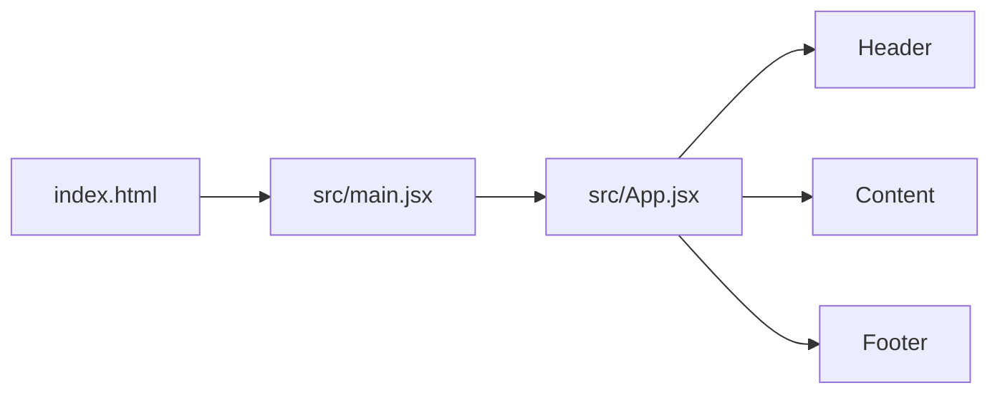

# Learning26

<div align="center">

**A beginner-friendly React practice playground built with Vite and JavaScript**

[](https://react.dev/)
[](https://vite.dev/)
[](https://developer.mozilla.org/docs/Web/JavaScript)
[](#license)

<br />


</div>

---

## What is Learning26?

Learning26 is a small React 19 application created as a MERN stack learning exercise. It demonstrates the foundation of component-based development: rendering UI, importing CSS, combining reusable components, and using JavaScript expressions inside JSX.

The current interface is intentionally simple and serves as a clean starting point for future experiments.

## Live app flow



<details open>
<summary><strong>Explore the live component structure</strong></summary>

| Component | Responsibility |
|---|---|
| [`Header`](src/components/Header.jsx) | Renders the top banner with the text `HEADER` |
| [`Content`](src/components/Content.jsx) | Demonstrates variables, objects, JSX expressions, and conditional rendering |
| [`Footer`](src/components/Footer.jsx) | Renders the bottom banner with the text `FOOTER` |

</details>

<details>
<summary><strong>See what the Content component renders</strong></summary>

- A React welcome heading
- The year `2026`
- Country: `India`
- The active status resolved by a ternary expression
- A user ID and username from a JavaScript object

</details>

## Tech stack

| Area | Technology |
|---|---|
| UI library | React 19 |
| Build tool | Vite 8 |
| Language | JavaScript with JSX |
| Styling | Plain CSS |
| Code quality | ESLint |

## Project structure

```text
learning26/
├── public/
│   ├── favicon.svg
│   └── icons.svg
├── src/
│   ├── assets/
│   │   ├── css/
│   │   │   ├── header.css
│   │   │   └── footer.css
│   │   └── hero.png
│   ├── components/
│   │   ├── Header.jsx
│   │   ├── Content.jsx
│   │   └── Footer.jsx
│   ├── App.jsx
│   ├── App.css
│   ├── index.css
│   └── main.jsx
├── index.html
├── package.json
└── vite.config.js
```

<details>
<summary><strong>Learn how the files work together</strong></summary>

- `main.jsx` mounts the React application into `#root`.
- `App.jsx` assembles the header, content, and footer.
- `Header.jsx` and `Footer.jsx` import their matching CSS files.
- `Content.jsx` contains JavaScript variables and demonstrates JSX rendering.
- `App.css` includes reusable starter styles.
- `index.css` provides global and template-level styles.
- `vite.config.js` enables the official React plugin.

</details>

## Getting started

### Prerequisites

- [Node.js](https://nodejs.org/) 20.19+ or 22.12+
- npm

### Installation

```bash
git clone https://github.com/Aastha-0777/mern-practice.git
cd mern-practice
npm install
```

### Run locally

```bash
npm run dev
```

Open the local URL printed by Vite, usually <http://localhost:5173>.

## Available commands

| Command | Description |
|---|---|
| `npm run dev` | Start the Vite development server |
| `npm run build` | Create an optimized production build |
| `npm run preview` | Preview the production build locally |
| `npm run lint` | Check JavaScript and JSX for ESLint issues |

## React concepts used

<details open>
<summary><strong>1. Components</strong></summary>

The application is divided into `Header`, `Content`, and `Footer` components.

</details>

<details>
<summary><strong>2. JSX expressions</strong></summary>

Values are inserted into the UI using curly braces, such as `{year}` and `{country}`.

</details>

<details>
<summary><strong>3. Conditional rendering</strong></summary>

The active state is displayed with a ternary expression:

```jsx
{isActive ? "Active" : "Not Active"}
```

</details>

<details>
<summary><strong>4. JavaScript objects</strong></summary>

Object properties are accessed through JSX:

```jsx
{user.id}
{user.userName}
```

</details>

## Ideas for the next iteration

- [ ] Add navigation links to the header
- [ ] Replace placeholder content with a responsive landing page
- [ ] Create reusable card, button, and layout components
- [ ] Add React state with `useState`
- [ ] Add React Router
- [ ] Connect to a MERN backend
- [ ] Add tests

## License

This project is currently a personal learning project. Add a `LICENSE` file if you plan to distribute or license the repository publicly.

---

<div align="center">

Built by **Aastha** as part of MERN learning journey

</div>
